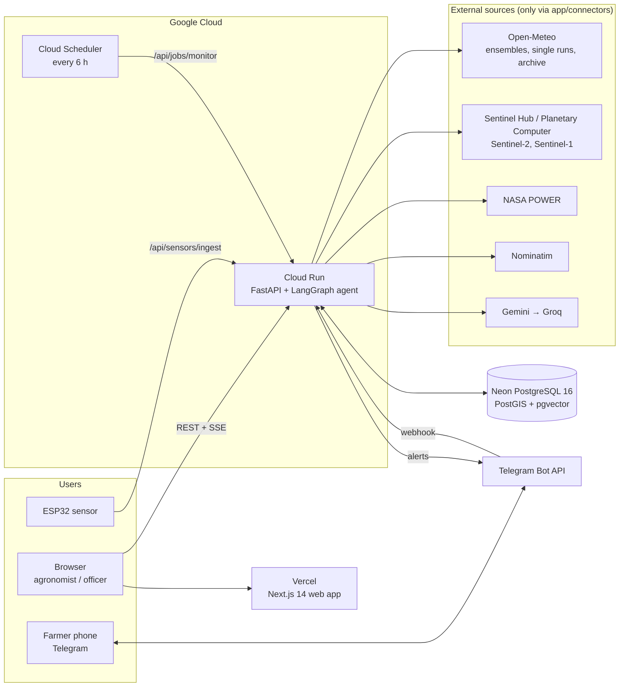
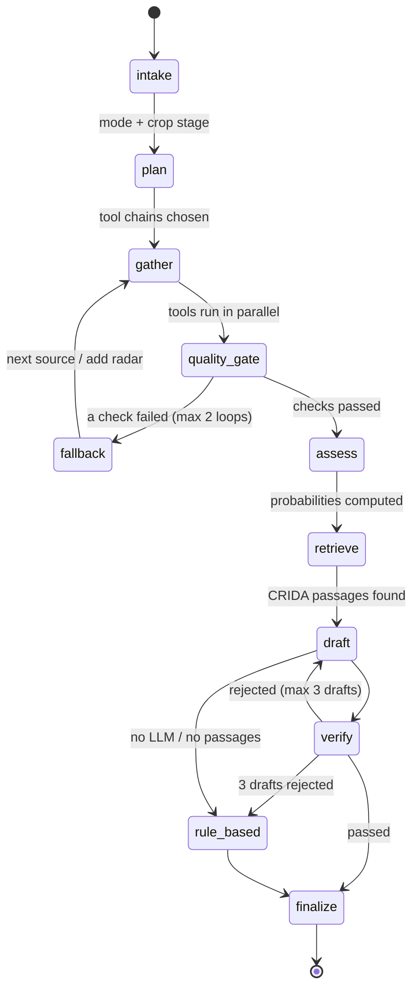

# KhetKavach (खेतकवच)

**Field-level climate early warning for Indian farms. FORGE 2026 submission.**


KhetKavach ("field shield") is an AI agent that watches a registered farm field from space and from the ground. It gives the probability of a dry spell, heavy rain or harvest-time rain over the next 15 days, and writes a dated action plan that cites the official ICAR-CRIDA district contingency plan, before the damage happens.

[](https://github.com/ZaroCoding/KhetiKavach/actions/workflows/ci.yml)


| Live app | API docs | Demo video | Deck | Repo |
|---|---|---|---|---|
| TODO | TODO `<api-url>/docs` | TODO | TODO | [GitHub](https://github.com/ZaroCoding/KhetiKavach) |


## Contents

1. [Judges' quick answers](#1-judges-quick-answers)
2. [Problem and solution](#2-problem-and-solution)
3. [Features and why they matter](#3-features-and-why-they-matter)
4. [Architecture](#4-architecture)
5. [How an assessment works](#5-how-an-assessment-works)
6. [Reliability and edge cases](#6-reliability-and-edge-cases)
7. [API](#7-api)
8. [Quick start](#8-quick-start)
9. [Deployment](#9-deployment)
10. [Testing](#10-testing)
11. [FAQ](#11-faq)
12. [Tech stack and data sources](#12-tech-stack-and-data-sources)
13. [Limitations and roadmap](#13-limitations-and-roadmap)
14. [Team and license](#14-team-and-license)

---

## 1. Judges' quick answers

| Rubric pillar | Our answer | Where to see it |
|---|---|---|
| **Live demo and robustness (30)** | Every number comes from a live API, a cache of real responses, or an official dataset, and shows its `source`, `fetched_at` and `status`. Any of the 16 sources can be switched off live, and the agent falls back on its own. | `/app` → Admin → disable a source → Assess; the Sources panel; `GET /health` |
| **Agentic AI (25)** | A LangGraph agent plans, calls tools in parallel, runs quality gates, falls back to other sources, and a deterministic verifier rejects any number or claim not in the evidence, with up to 3 redrafts before a rule-based plan. | The live agent trace in `/app`; [`agent/graph.py`](apps/api/app/agent/graph.py), [`rag/verifier.py`](apps/api/app/rag/verifier.py) |
| **Impact and USP (25)** | Probabilities for one registered field at its current crop stage, with page-cited CRIDA actions in English, Hindi and Punjabi, and Telegram alerts for farmers. | Time Machine → "Mar 2026 harvest rain"; the language switch |
| **Technical depth (20)** | ECMWF (51) + GEFS (31) ensemble counting, Sentinel-2 optical + Sentinel-1 radar, hybrid vector + full-text retrieval, a leak-free LightGBM model evaluated honestly. | [Section 5](#5-how-an-assessment-works); `GET /api/model` |

---

## 2. Problem and solution

India has weather data. What it lacks is data at the right **scale, format and moment**:

- Forecast grids are about 25 km wide; farm decisions are made on 1–2 hectare fields.
- Farmers get "rain likely" instead of a probability they can act on.
- Optical satellites are blind under monsoon clouds, exactly when crops are most at risk.
- ICAR-CRIDA has written contingency plans for 600+ districts, but they sit in PDFs and are rarely triggered in time.
- AI chatbots give fluent advice but invent numbers and cite nothing.

KhetKavach joins these pieces: forecast ensembles, satellites, 30-year IMD climatology and the CRIDA plans, run by an agent that checks its own work.

### Lead case: March 2026 harvest rain, Ludhiana wheat

A real wheat field in Ludhiana (sown 10 Nov 2025) replayed with the **Time Machine** as of **15 March 2026**, using the ECMWF forecast actually issued that morning (no look-ahead):

| Item | Result |
|---|---|
| Hazard / crop stage | Harvest rain at the ripening stage (stage weight 1.0) |
| Forecast | The ECMWF IFS run of 2026-03-15 00 UTC showed rain above the threshold (≥ 15.6 mm/day or ≥ 25 mm in 3 days) |
| Usual chance (IMD 1991–2020) | 13% for this window |
| Severity | **Severe** |
| Plan | Cited the Ludhiana CRIDA plan: postpone harvest, open drainage channels, cover harvested sheaves |

A single archived run is a yes/no outcome, not a probability, and the card says so. Official source for the March 2026 event: **TODO: add IMD/ICAR advisory link.**

Supporting history: August 2023 was India's driest August since records began in 1901, and contingency plans existed but were not triggered for individual fields.

---

## 3. Features and why they matter

| Feature | Why it matters | Who it helps |
|---|---|---|
| **Field registration** (draw a polygon, crop, sowing date) | Replaces district-wide forecasts with this field's own crop stage | Agronomists, farmers |
| **Agentic assessment** | Gathers data from many sources automatically, instead of someone checking several portals | Agronomists, KVK officers |
| **Live agent trace** | Shows every step, tool call, check and retry as it happens | Judges, auditors |
| **Quality gates + fallbacks** | Catches cloudy, stale or missing data and switches source instead of failing silently | Everyone |
| **Ensemble probabilities + 90% range vs usual chance** | Real odds instead of a yes/no guess | Agronomists, insurers |
| **NDVI vs this field's own history** | Tells real crop stress apart from normal seasonal change | Crop scouts |
| **Sentinel-1 radar fallback** | Keeps crop monitoring going under monsoon clouds | Kharif farmers |
| **Provenance panel** | Every value shows its source and fetch time | Everyone |
| **Cited CRIDA plan** | Actions written by agricultural scientists, with page references | KVK officers, farmers |
| **Deterministic verifier** | Blocks invented numbers, dates and uncited actions | Farmers |
| **English / हिन्दी / ਪੰਜਾਬੀ** | Advice in the farmer's language | Farmers |
| **Time Machine** | Shows how it would have performed on real past events | Judges, researchers |
| **Admin kill switch** | Proves failover live | Operators, judges |
| **6-hourly monitoring + Telegram alerts** | Warns farmers automatically, with nothing to install | Farmers, district officers |
| **ESP32 soil sensor (optional)** | Real in-field soil moisture where hardware exists | Precision farms |

### Why not a chatbot, a weather app or a government portal?

| | Chatbot | Weather app | Govt portal | **KhetKavach** |
|---|---|---|---|---|
| Scale | None | City / ~25 km | Expert GIS maps | **One field** |
| Crop stage | Guessed | None | None | **From the sowing date** |
| Uncertainty | Invented text | Single forecast | None | **51 + 31 ensemble members** |
| Under monsoon clouds | — | — | Blind | **Radar fallback** |
| Advice | Can invent | None | Static PDFs | **Cited CRIDA plan, verified** |
| Reaches farmers | Web login | App download | Desktop | **Telegram, in their language** |

<details>
<summary><b>Screenshots</b></summary>

| View | Screenshot |
|---|---|
| Landing with live status |  |
| Dashboard |  |
| Agent trace |  |
| Risk card |  |
| Plan in Hindi |  |
| Time Machine (Mar 2026) |  |
| Admin kill switch |  |
| Mobile |  |

</details>

---

## 4. Architecture



The browser only talks to our API (plus map tiles). All external calls go through `apps/api/app/connectors`, which apply a timeout, one retry, a fallback source and a read-through cache. A single PostgreSQL database holds fields, assessments, the agent trace, the IMD climatology, the CRIDA chunks with their vectors, and the cache.

| Repo folder | What it holds |
|---|---|
| `apps/api/app/agent` | LangGraph graph, tools, quality gates, evidence book |
| `apps/api/app/connectors` | All external I/O: weather, satellite, IMD, LLM, Telegram |
| `apps/api/app/risk` | Crop stages, ensemble counting, LightGBM model |
| `apps/api/app/rag` | CRIDA PDF text, embeddings, retriever, verifier, rule-based plan |
| `apps/api/app/routers` | REST and SSE endpoints |
| `apps/api/scripts` | Data loading, training, admin, edge-case checks |
| `apps/web` | Next.js app: map, trace, risk card, panels |
| `docs/` | `CONTRACTS.md` (API shapes), `ARCHITECTURE.md`, `STRATEGY.md` |
| `infra/`, `firmware/` | Deployment guide, ESP32 sketch |

---

## 5. How an assessment works



1. **Request:** `POST /api/assessments` returns `202` at once. The agent runs in the background, and the browser follows `/api/assessments/{id}/stream` (SSE).
2. **Gather:** sources run in parallel, each with its own fallback chain:
   - forecast: ECMWF ensemble → GEFS → multi-model
   - optical: Sentinel Hub → Planetary Computer
   - radar: Sentinel-1 (added when optical data is cloudy)
   - rain so far: Open-Meteo → NASA POWER
   - soil: ERA5-Land or the ESP32 sensor
   - usual chance: IMD climatology
3. **Quality gate:** catches more than 30% cloud, a scene older than 12 days, stale forecasts or missing members, then triggers a fallback or adds radar.
4. **Risk (pure Python, no LLM):** for each ensemble member, the engine checks the hazard rules:
   - dry spell: ≥ 10 days in a row under 2.5 mm
   - heavy rain: ≥ 20 mm in a day, or ≥ 50 mm in 3 days
   - harvest rain: ≥ 15.6 mm in a day, or ≥ 25 mm in 3 days (ripening stage only)

   Probability = the share of members that meet the rule, with a 90% Wilson interval, compared with the IMD usual chance and weighted by crop stage. The result is then banded into a severity level.
5. **Retrieve:** CRIDA passages for this district and scenario, found by hybrid vector + full-text search (reciprocal rank fusion).
6. **Draft and verify:** Gemini drafts the wording (Groq is the backup). The verifier checks:
   - every number exists in the evidence (after converting Hindi/Punjabi digits);
   - dates fall inside the 15-day window;
   - every action cites a retrieved passage.

   After 3 failed drafts, the rule-based plan quotes the passages directly.
7. **Finalize:** the result is saved with provenance on every value. The status is `completed`, or `completed_degraded` with the reason.

**Time Machine:** for dates from 2024-03-14 on, it replays the archived forecast issued that day (Open-Meteo Single Runs). Earlier dates use the LightGBM model on observed rain up to the day before. Rain that fell afterwards is shown for comparison only and is never an input.

**Alerts:** Cloud Scheduler calls `/api/jobs/monitor` every 6 hours. Subscribed fields are assessed, and a high-risk result sends a Telegram message in the farmer's language, deduplicated by message hash. Farmers subscribe by sending `/start <FIELD CODE> <en|hi|pa>` to the bot.

---

## 6. Reliability and edge cases

| Failure | Fallback | What the user sees |
|---|---|---|
| ECMWF ensemble down | GEFS → multi-model → cache | `completed_degraded`, source noted |
| Sentinel Hub down / no credentials | Planetary Computer | Source noted |
| Cloudy optical scene | Sentinel-1 radar added | Last clear scene age + radar |
| Gemini error / quota | Groq | Same plan format |
| Both LLMs fail, or verifier rejects 3 times | Rule-based plan quoting CRIDA | Plan labelled `rule_based` |
| Any source fails, no cache | — | Value shown as `unavailable`, never a placeholder |
| Database down at start | API keeps running | `/health` returns 503 |
| Telegram send fails | Error logged | Webhook still returns 200 |

**Real output of `uv run python -m scripts.edge_cases`:**

```text
PASS  self-intersecting polygon: 422 polygon is invalid (Self-intersection[...]); redraw it without crossing edges
PASS  outside India: 422 field lies outside India
PASS  over 50 ha: 422 field is 424.4 ha; the limit is 50 ha (draw one field)
PASS  future sowing date: 422 sowing date is in the future
PASS  unknown crop: 422 Input should be 'wheat', 'rice', 'cotton' or 'soybean'
PASS  unknown district: 422 unknown district_code; use one of PB_LUDHIANA, KA_DHARWAD
PASS  unknown assessment: 404
PASS  as_of before 2021: 422
```

<details>
<summary><b>More handled cases</b></summary>

| Case | Result |
|---|---|
| `as_of` in the future / before sowing | 422 with the reason |
| `as_of` = today | Treated as a live run |
| Unknown field id | 404 |
| Number in the plan not in the evidence | Verifier rejects → redraft |
| Uncited action | Verifier rejects |
| Hindi/Punjabi digits in the plan | Converted to normal digits before checking |
| Forecast member with missing hours | Member excluded and noted on the card |
| Wrong or missing `X-Admin-Key`, `X-Device-Key` or Telegram secret | 401 (constant-time comparison) |
| Sensor values out of physical range | 422 |
| No sensor reading in 24 h | Falls back to modelled soil moisture |

</details>

**Known gaps:**
- An assessment running during a server restart stays marked "running".
- There is no district roll-up dashboard yet.
- The app needs a network connection; there is no offline mode.

---

## 7. API

Full request and response shapes are in [`docs/CONTRACTS.md`](docs/CONTRACTS.md). Interactive docs are at `/docs`.

| Method | Path | Auth | Purpose |
|---|---|---|---|
| GET | `/health` | — | DB and source health; 503 if the DB is down |
| GET | `/api/districts` | — | Supported districts and CRIDA chunk counts |
| GET | `/api/geocode?q=` | — | Village search (Nominatim) |
| GET | `/api/model` | — | Model card (real metrics) |
| GET / POST | `/api/fields` | — | List / register a field |
| POST | `/api/assessments` | — | Start an assessment (`202`) |
| GET | `/api/assessments/{id}` | — | The result |
| GET | `/api/assessments/{id}/stream` | — | Live trace (SSE) |
| GET | `/api/admin/sources` | `X-Admin-Key` | Source status |
| POST | `/api/admin/sources/{s}/disable` · `/enable` | `X-Admin-Key` | Kill switch |
| POST | `/api/jobs/monitor` | `X-Admin-Key` | 6-hourly monitor |
| POST | `/api/sensors/ingest` | `X-Device-Key` | ESP32 reading |
| POST | `/api/telegram/webhook` | Telegram secret | Bot subscriptions |

Trace events: `node_started`, `tool_result`, `gate_failed`, `fallback_used`, `verifier_rejected`, `error`, `done`. Every error uses one envelope: `{"error": {"code", "message", "details"}}`.

---

## 8. Quick start

**You need:** Git, Python 3.11, [uv](https://docs.astral.sh/uv/), Node 20+, and pnpm (`corepack enable`). Docker is optional.

```bash
git clone https://github.com/ZaroCoding/KhetiKavach.git
cd KhetiKavach
cp apps/api/.env.example apps/api/.env        # PowerShell: Copy-Item apps/api/.env.example apps/api/.env
```

Fill in `apps/api/.env`:

| Variable | Required | Where to get it |
|---|---|---|
| `DATABASE_URL` | Yes | Neon (direct connection string) or local Docker DB |
| `ADMIN_KEY` | Yes | Any long random string |
| `CORS_ORIGINS` | Yes | `http://localhost:3000` |
| `GEMINI_API_KEY` | Yes | [Google AI Studio](https://aistudio.google.com) |
| `GEMINI_MODEL` | No | `gemini-flash-latest` |
| `GROQ_API_KEY` | No | [Groq console](https://console.groq.com) (LLM backup) |
| `SATELLITE_PRIMARY` | No | `planetary_computer_s2` (no key needed) or `sentinel_hub` |
| `CDSE_CLIENT_ID` / `CDSE_CLIENT_SECRET` | No | Copernicus Data Space (only for `sentinel_hub`) |
| `TELEGRAM_BOT_TOKEN` / `TELEGRAM_WEBHOOK_SECRET` | No | @BotFather / any random string |

Database: `docker compose up -d db`, or use Neon (PostgreSQL 16).

**Backend** (terminal 1):

```bash
cd apps/api
uv sync
uv run alembic upgrade head
uv run python -m scripts.ingest_crida --district PB_LUDHIANA
uv run python -m scripts.ingest_crida --district KA_DHARWAD
uv run --group data python -m scripts.load_imd --district PB_LUDHIANA
uv run --group data python -m scripts.load_imd --district KA_DHARWAD
uv run python -m scripts.train_dryspell
uv run uvicorn app.main:app --reload --port 8000
```

**Frontend** (terminal 2):

```bash
cd apps/web
echo NEXT_PUBLIC_API_URL=http://localhost:8000 > .env.local
pnpm install
pnpm dev
```

The PowerShell commands are the same; use `cd apps\api` and `cd apps\web`.

**Check it works:** open http://localhost:8000/health (it should show `db: ok`), then http://localhost:3000. Draw a field and click **Assess**.

**Everything in Docker:** `docker compose up --build` (web on 3000, API on 8080).

<details>
<summary><b>Troubleshooting</b></summary>

- **`channel_binding` error:** remove `&channel_binding=require` from `DATABASE_URL`.
- **Empty panels or a CORS error:** check that `CORS_ORIGINS` includes `http://localhost:3000` and that `.env.local` points to port 8000, then restart both servers.
- **Gemini 429 (quota):** add `GROQ_API_KEY`; the backup takes over automatically.
- **No plan citations:** run `ingest_crida` for both districts.

</details>

---

## 9. Deployment

Full steps are in [`infra/deploy.md`](infra/deploy.md).

1. **Database:** Neon PostgreSQL 16; migrations run automatically when the container starts.
2. **API:** Cloud Run (`--no-cpu-throttling --min-instances=1`), with secrets from Secret Manager.
3. **Web:** Vercel, root `apps/web`, with `NEXT_PUBLIC_API_URL=<api-url>`.
4. **Monitoring:** Cloud Scheduler, `POST <api-url>/api/jobs/monitor` every 6 hours, with the `X-Admin-Key` header.
5. **Telegram webhook** (once):
   ```bash
   curl "https://api.telegram.org/bot<TOKEN>/setWebhook?url=<api-url>/api/telegram/webhook&secret_token=<WEBHOOK_SECRET>"
   ```

---

## 10. Testing

```bash
cd apps/api && uv run ruff check . && uv run mypy app && uv run pytest
cd apps/web && pnpm lint && pnpm typecheck && pnpm test && pnpm build
uv run python -m scripts.edge_cases --base http://127.0.0.1:8000
```

Latest run: **TODO: paste the real counts (pytest passed / vitest passed).** CI runs the same checks plus migrations up/down/up on every push.

---

## 11. FAQ

<details open><summary><b>Is any data dummy?</b></summary>

No. Every number comes from a live API, a database cache of real responses, or an official dataset (IMD, CRIDA), and carries its source, fetch time and status. If no real value exists, it shows `unavailable`.
</details>

<details><summary><b>How is the probability calculated?</b></summary>

By counting forecast ensemble members. For example, if 17 of 51 ECMWF members show a dry spell, the probability is 33%, shown with a 90% Wilson interval and compared with the IMD 1991–2020 usual chance. Severity combines that probability with the crop-stage weight. The LLM computes nothing.
</details>

<details><summary><b>What happens when Sentinel-2 is cloudy?</b></summary>

The quality gate rejects scenes with more than 30% cloud, or older than 12 days. The agent keeps the last clear scene (and shows its age) and adds Sentinel-1 radar, which sees through clouds.
</details>

<details><summary><b>What does the LLM do, and how is it kept honest?</b></summary>

It only writes the wording, in English, Hindi or Punjabi. The verifier rejects any number not in the evidence, any date outside the window, and any action without a CRIDA citation. After 3 failed drafts, a rule-based plan quotes CRIDA directly.
</details>

<details><summary><b>Why is the Time Machine leak-free?</b></summary>

It uses the forecast run actually issued on that date (Open-Meteo Single Runs), not stitched historical forecasts. Before 2024-03-14, it uses the model on rain observed up to the day before. Later rain is shown only for comparison.
</details>

<details><summary><b>How good is the ML model?</b></summary>

LightGBM dry-spell model: Brier skill score **+0.0056** over climatology, ROC-AUC **0.838** (see `/api/model`). That is only slightly better than climatology, so ensemble probabilities are the main signal and the model is a fallback.
</details>

<details><summary><b>What does "field level" mean if weather grids are ~25 km?</b></summary>

The weather forecast stays at grid scale. What is field-specific: the boundary, the crop stage from the sowing date, NDVI from 10 m pixels compared with the field's own history, and soil readings from a sensor where one exists.
</details>

<details><summary><b>How does it scale beyond two districts?</b></summary>

Ludhiana (irrigated wheat, harvest rain) and Dharwad (rainfed soybean, monsoon dry spells) cover two contrasting risks. Adding a district means loading its CRIDA PDF and IMD cells with the existing scripts.
</details>

<details><summary><b>What does it cost to run, and how do farmers get alerts?</b></summary>

It runs on free tiers: Cloud Run, Neon, Vercel, Gemini, Open-Meteo and Planetary Computer. Agronomists use the web app; farmers get Telegram alerts in their language and don't need the app.
</details>

---

## 12. Tech stack and data sources

| Layer | Technology |
|---|---|
| Web | Next.js 14, React 18, TypeScript, Tailwind 4, MapLibre GL, Terra Draw, Recharts |
| API | Python 3.11, FastAPI, Pydantic v2, LangGraph, asyncpg (plain SQL), Alembic |
| AI/ML | Gemini Flash (Groq backup), fastembed multilingual MiniLM (384-d), LightGBM |
| Data | PostgreSQL 16 + PostGIS + pgvector (Neon) |
| Infra | Cloud Run, Vercel, Cloud Scheduler, Docker, GitHub Actions, Telegram Bot API |

| Source | Used for | Terms |
|---|---|---|
| [Open-Meteo](https://open-meteo.com) | ECMWF / GEFS ensembles, single runs, ERA5-Land | CC BY 4.0 |
| [Copernicus Data Space](https://dataspace.copernicus.eu) | Sentinel-2 statistics | Copernicus open access |
| [Microsoft Planetary Computer](https://planetarycomputer.microsoft.com) | Sentinel-2 and Sentinel-1 RTC | Open access |
| [IMD](https://www.imdpune.gov.in) | Gridded daily rainfall (climatology, model) | Govt of India open data |
| [ICAR-CRIDA](http://www.crida.in) | District contingency plans | Govt of India |
| [NASA POWER](https://power.larc.nasa.gov) | Rainfall fallback | Public domain |
| [OpenStreetMap / Nominatim](https://nominatim.openstreetmap.org) | Village search | ODbL |

---

## 13. Limitations and roadmap

**Limitations:** weather is at about 25 km resolution; only two districts are covered; the ML model barely beats climatology; there is no offline mode; there is no district roll-up view yet.

**Next:** onboard more CRIDA district plans; add SMS/voice alerts for farmers without smartphones; build a district officer risk heatmap; add more crops.

---

## 14. Team and license

| Name | Role |
|---|---|
| Chand Aalam| Leader |
| Siddharth Verma | Member |
| Babul Pradhan | Member |

Thanks to ICAR-CRIDA, IMD, ESA/Copernicus, ECMWF and Open-Meteo, NASA POWER, Microsoft Planetary Computer and OpenStreetMap contributors.

Licensed under the [MIT License](LICENSE) © 2026 KhetKavach contributors.
