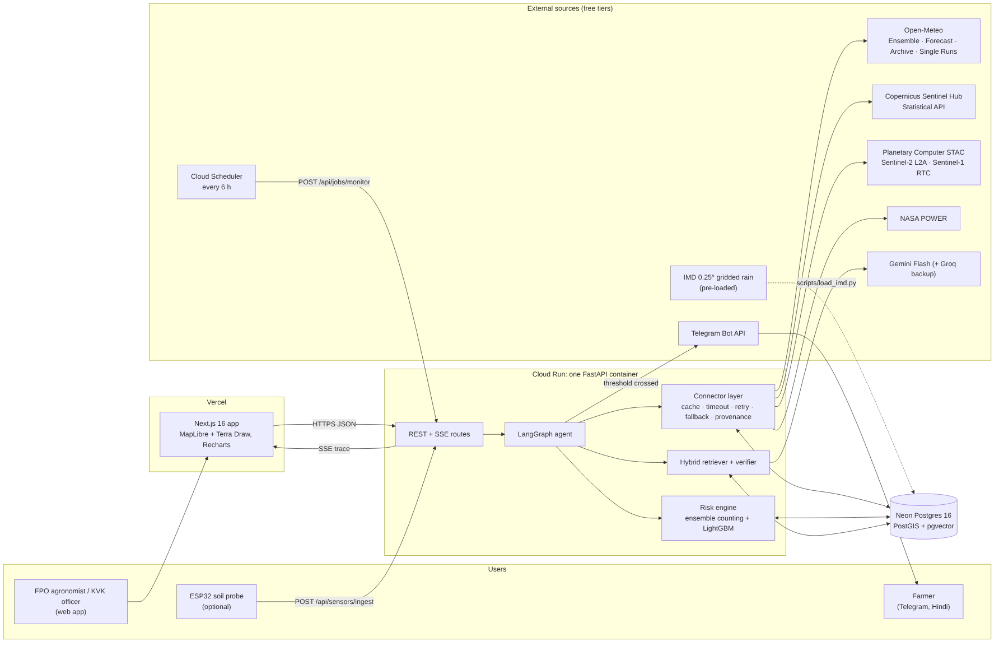

# KhetKavach (खेतकवच): field-level climate early warning

India has plenty of weather data. What farmers lack is a forecast for **one field, this week**, and
the action that field needs. KhetKavach watches each registered field and gives the **probability**
of a damaging dry spell, heavy rain or rain at harvest over the next 15 days. It then writes a
**dated action plan quoted from the district's official ICAR-CRIDA contingency plan**, with every
number checked by a deterministic verifier.

**Users:** FPO agronomists and KVK officers who look after many fields (web app), and the farmers
they serve (Telegram alerts in Hindi or Punjabi). Demo districts: **Ludhiana** (Punjab) and
**Dharwad** (Karnataka).



## What makes it different
- **Probabilities, not adjectives:** share of 51 ECMWF + 31 NOAA GEFS ensemble members crossing
  crop-relevant thresholds, with a 90% interval, next to the IMD 1991–2020 frequency for the window.
- **Field evidence:** Sentinel-2 NDVI/NDMI vs the field's own 2017+ history; Sentinel-1 radar when
  monsoon cloud blinds optical imagery.
- **Plans you can audit:** hybrid retrieval over the CRIDA plans; every action cites a page; the
  verifier rejects numbers not in the evidence and dates outside the window (Hindi digits too).
- **A visible, self-correcting agent:** LangGraph with quality gates and source fallback chains,
  streamed live over SSE.
- **Proof without hindsight:** Time Machine replays the forecast actually issued on a past date
  (from 2024-03-14) or, earlier, a LightGBM model on rain observed up to the day before.

## Repository
| Path | What |
|---|---|
| `apps/api` | FastAPI: connectors, risk engine, LangGraph agent, RAG + verifier, routes, Alembic, scripts, tests |
| `apps/web` | Next.js 14: MapLibre + Terra Draw map, live trace, risk card, charts, admin kill switch |
| `docs/CONTRACTS.md` | API shapes, SSE events, tables — FROZEN, rulings B-1..B-21 |
| `docs/ARCHITECTURE.md` | Components and the agent graph |
| `docs/ANTIGRAVITY_PROMPTS.md` | Verify/fix/finish prompts per phase, utility prompts, demo script |
| `data/` | The two CRIDA plan PDFs and the data-loading guide |
| `infra/` | Local Postgres image and the deploy guide |
| `.agents/` | Antigravity workspace rules and workflows |
| `firmware/` | Optional ESP32 soil-probe sketch |

## Run locally
```bash
cp .env.example .env && cp apps/api/.env.example apps/api/.env   # fill the keys
docker compose up --build            # Postgres+PostGIS+pgvector, API on :8080 (migrates), web on :3000
cd apps/api
uv run python -m scripts.ingest_crida --district PB_LUDHIANA      # and KA_DHARWAD
uv run --group data python -m scripts.load_imd --district PB_LUDHIANA   # and KA_DHARWAD
uv run python -m scripts.train_dryspell                            # model for pre-2024 Time Machine
```
Checks (as CI runs them): `uv run ruff check . && uv run ruff format --check . && uv run mypy app &&
uv run pytest` in `apps/api`; `pnpm lint && pnpm typecheck && pnpm test && pnpm build` in `apps/web`.

Deploy: `infra/deploy.md`.

## Status
| Area | State |
|---|---|
| Contracts | Frozen; all open questions and conflicts ruled (B-1..B-21) |
| API, agent, RAG, verifier, alerts, kill switch | Built; 31 tests; strict mypy clean |
| Database | Alembic migration, tested up/down/up on Postgres 16 + PostGIS + pgvector |
| Web app | Built; lint, typecheck, 8 tests, production build pass |
| CRIDA ingestion | Scenario segmentation verified on both real PDFs (`--dry-run`) |
| Live data sources | **Not yet exercised** (build sandbox had no outbound access): Phase 2–3 prompts |
| IMD load, model training, deploy | To do with real credentials: see `data/README.md`, `infra/deploy.md` |

## Honest limits
- Forecasts are on a ~25 km grid; field detail comes from 10 m pixels and the optional probe.
- We report yield-risk exposure (hazard × stage), not tonnes per hectare.
- An archived single run is a yes/no outcome, so the UI shows YES/NO, not a percentage.
- CRIDA plans date from 2011; each citation shows its year. Rice stage weights are team-set.
- District boundaries come from OpenStreetMap; swap in an official boundary if available.

## Data and attribution
Open-Meteo (CC BY 4.0; ECMWF, NOAA, ERA5/ERA5-Land) · Copernicus Sentinel-2/1 via Copernicus Data
Space and Microsoft Planetary Computer · IMD Pune gridded rainfall (imdlib) · NASA POWER ·
ICAR-CRIDA contingency plans · © OpenStreetMap contributors (Nominatim) · Esri World Imagery basemap.
