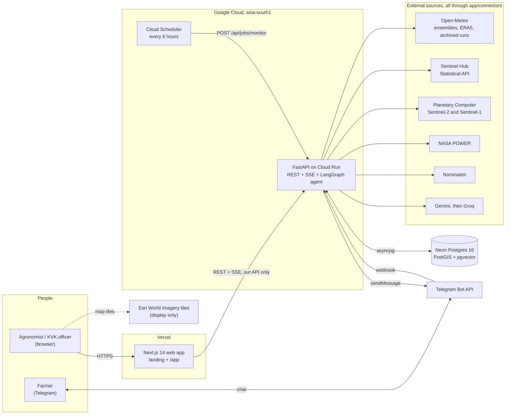
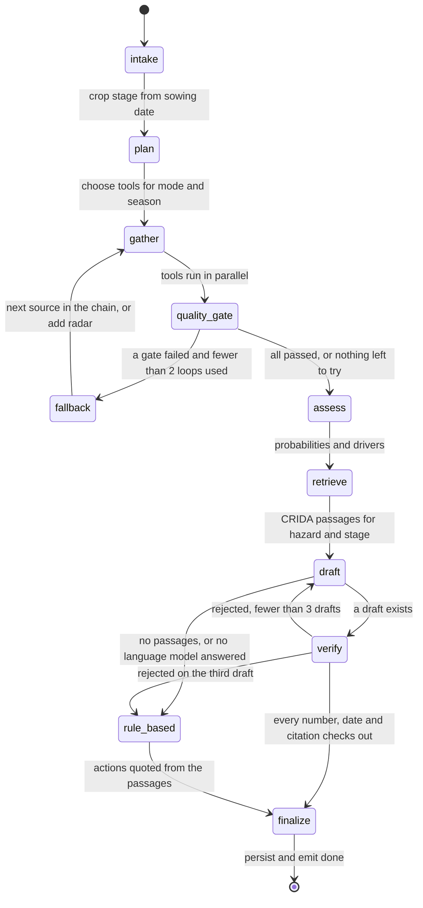
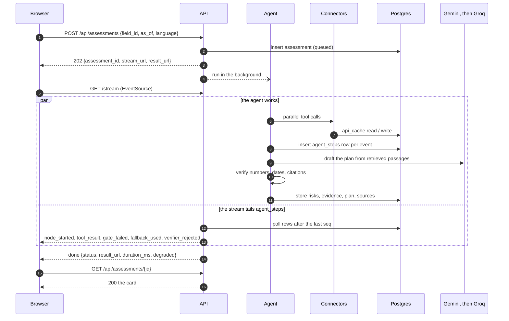
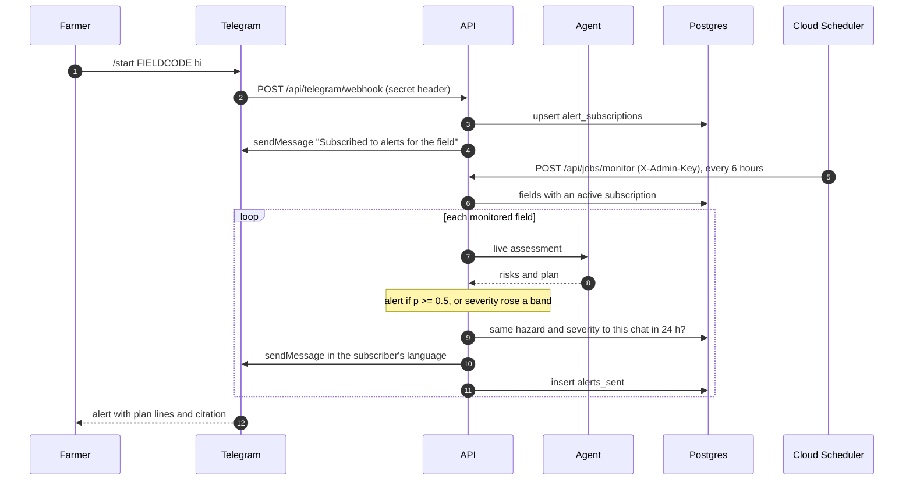
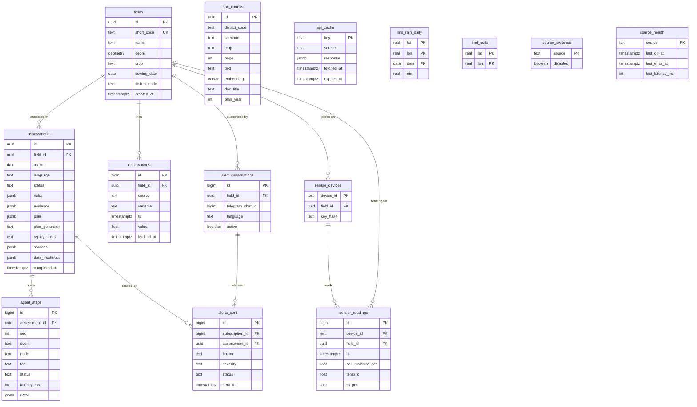
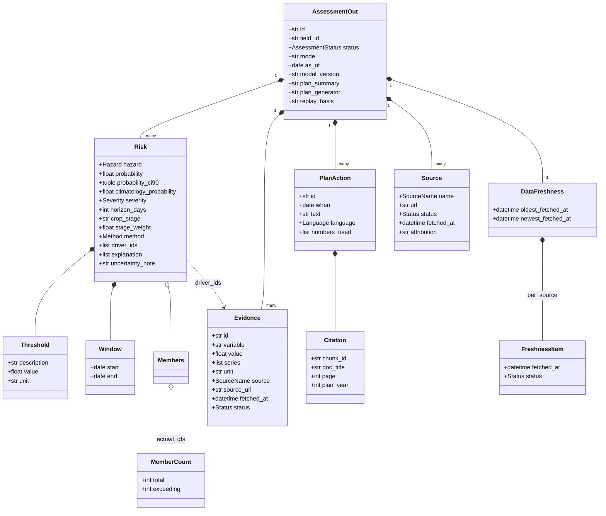

> **TODO before submission. The team fills these in; nothing below invents them.**
>
> - Live app URL: `TODO: add the Vercel URL`
> - Live API URL (and its `/docs`): `TODO: add the Cloud Run URL`
> - Demo video: `TODO: add the video link`
> - Slide deck: `TODO: add the deck link`
> - Team names and roles: `TODO: add the team` (see [Team](#team-and-acknowledgements))
> - Official 2026 source for the March 2026 rain case: `TODO: add IMD 2026 source` (see [the lead case](#the-march-2026-harvest-rain-case))
> - Running cost: `TODO: confirm the real Cloud Run bill after the event` (see [FAQ](#faq))

<div align="center">

# KhetKavach (खेतकवच)

**A field-level early warning agent. It gives the probability of a dry spell, heavy rain or rain at harvest for one registered field, then writes a dated, cited action plan before the damage happens.**

[](https://github.com/ZaroCoding/khetikavach/actions/workflows/ci.yml)


[**Live app**](#) · [**Video**](#) · [**Deck**](#) · [**API /docs**](#) · [GitHub](https://github.com/ZaroCoding/khetikavach)

<sub>The four links above are placeholders until the TODO list at the top is filled in.</sub>


</div>

## Contents

1. [Judges' quick answers](#judges-quick-answers)
2. [FAQ](#faq)
3. [Problem and solution](#problem-and-solution)
4. [Features](#features)
5. [Architecture](#architecture)
6. [Tech stack](#tech-stack)
7. [Data sources and licences](#data-sources-and-licences)
8. [API reference](#api-reference)
9. [Quick start](#quick-start)
10. [Deployment](#deployment)
11. [Testing](#testing)
12. [Robustness and security](#robustness-and-security)
13. [ESP32 soil sensor (optional)](#esp32-soil-sensor-optional)
14. [Limitations and roadmap 2026-27](#limitations-and-roadmap-2026-27)
15. [Team and acknowledgements](#team-and-acknowledgements)

## Judges' quick answers

| Pillar (weight) | Short answer | Where to see it |
|---|---|---|
| **Live demo and robustness (30)** | Every number is read live from a real source, with its source, status and fetch time. A source that fails shows as *unavailable*, never a stand-in. Each source has a timeout, one retry, a cache and a named fallback, and an admin switch turns any of 16 sources off during the demo. | `/app` → **Admin** panel, then **Assess** and watch the trace fall back. [Robustness and security](#robustness-and-security). `GET /health` |
| **Agentic AI (25)** | A LangGraph agent plans which tools to call, runs them in parallel, checks their quality (cloud, staleness, gaps), switches source or adds Sentinel-1 radar when a check fails, then drafts a plan that a deterministic verifier can reject and send back for a redraft. Every step streams live. | The **Agent trace** panel in `/app`. [State diagram](#the-agent-langgraph). `apps/api/app/agent/graph.py` |
| **Impact and USP (25)** | A probability for *one field*, tied to its crop stage, with an action plan quoted from the district's official ICAR-CRIDA contingency plan (page cited), in English, Hindi or Punjabi, plus Telegram alerts. Time Machine replays what was knowable on a past date. | [The March 2026 case](#the-march-2026-harvest-rain-case). `/app` → **Time Machine** |
| **Technical depth (20)** | Ensemble member counting (51 ECMWF + 31 GEFS), Sentinel-2 and Sentinel-1 pipelines with two optical sources, hybrid pgvector + full-text retrieval, a verifier that checks every number and date, a LightGBM model evaluated against climatology and reported honestly, and an SSE trace persisted for replay. | [Architecture](#architecture), [Testing](#testing), `docs/CONTRACTS.md` (rulings B-1 to B-25) |

## FAQ

<details>
<summary><b>Is any data dummy or hard-coded? Where does each number come from?</b></summary>

No. Every value comes from a live API, the database, or an official open dataset, and carries a `source`, `fetched_at` and `status` (`live`, `cached`, `archived`, `unavailable`) from the connector to the database, the API response and the screen. If a source has no real value the field says *unavailable*. Hand-built numbers exist only in `apps/api/tests/` and `apps/web/tests/`, for logic tests whose answer can be worked out by hand; they never reach app code, the database or the UI. Every screenshot in this README is a picture of a real run.

| What you see | Where it comes from |
|---|---|
| Rain probabilities | Open-Meteo Ensemble API: ECMWF IFS 0.25° (51 members) and NOAA GEFS 0.25° (31 members) |
| "Usual chance for this window" | IMD 0.25° gridded daily rainfall, 1991-2020, loaded into Postgres by `scripts/load_imd.py` |
| NDVI / NDMI | Sentinel-2 L2A via the Copernicus Sentinel Hub Statistical API, with Microsoft Planetary Computer as the fallback |
| Radar (VV, VH, RVI) | Sentinel-1 RTC via Planetary Computer |
| Soil moisture and its percentile | ERA5-Land through Open-Meteo, 10-year same-season history |
| Rain in the last 30 days | Open-Meteo Forecast API (`past_days`), NASA POWER as the fallback |
| Time Machine forecast and "what fell afterwards" | Open-Meteo Single Runs API (the archived ECMWF IFS run) and ERA5 via the Archive API |
| Action text and its page number | ICAR-CRIDA district contingency plans (2011), reworded by Gemini (Groq as backup) |
| District boundaries | OpenStreetMap, through Nominatim |
| Crop-stage weights | FAO-33 yield-response factors and FAO-56 stage lengths; rain sensitivity and rice's factors are marked *team-set* in `app/risk/crops.py` |

</details>

<details>
<summary><b>How is the probability computed?</b></summary>

It is a count, not a guess. For each ensemble member the engine checks the event against that member's daily rain, then divides:

- **Dry spell:** at least 10 consecutive days under 2.5 mm.
- **Heavy rain:** any day of 20 mm or more, or any 3-day total of 50 mm or more.
- **Rain at harvest** (only while the crop is ripening): any day of 15.6 mm or more, or any 3-day total of 25 mm or more.

*17 of 51 members dry for 10 days = 0.333.* The card also shows a 90% Wilson interval, the member counts for ECMWF and GEFS, and the IMD frequency of the same event in the same window. Severity is `probability x stage weight`, banded low (under 0.2), moderate, high (0.45), severe (0.7). Members that cover fewer than 10 days are left out of a dry-spell count and the card says so. When only the multi-model fallback is available, the agreement between five deterministic models is shown and labelled "not a calibrated probability". An archived single run is a yes/no outcome and the UI shows YES or NO, never a percentage. Thresholds are in `app/risk/engine.py` and ruling B-3.

</details>

<details>
<summary><b>What happens when Sentinel-2 is cloudy?</b></summary>

A quality gate runs after every tool call. If the newest scene has more than 30% cloud over the field, or the last clear scene is more than 12 days old, the agent emits `gate_failed` with `check: "cloud"` and the reason, keeps the last clear scene (showing its age) and adds Sentinel-1 radar, which sees through cloud. In June to September radar is planned from the start. Switching optical source does not help because both see the same cloud, so the gate adds radar instead. The thresholds are `MAX_CLOUD_FRACTION` and `MAX_OPTICAL_AGE_DAYS`. Pixels flagged as cloud, shadow, cirrus or snow by the scene classification are masked before NDVI is computed, and a scene whose band values are corrupt (squeezed into 0-255, which Planetary Computer served on 2026-10-28 and -29) is dropped.

</details>

<details>
<summary><b>How does the agent correct itself?</b></summary>

Three loops, all visible in the trace and stored in `agent_steps`:

1. **Source fallback.** A failed or low-quality input moves down its chain: ECMWF ensemble → GEFS ensemble → five-model comparison; Sentinel Hub ↔ Planetary Computer; Open-Meteo recent rain → NASA POWER. At most two gather loops.
2. **Radar on cloud**, as above.
3. **Redraft.** If the verifier rejects the plan, the rejection reasons go back to the language model for another draft, up to three drafts in total. If none passes, or no language model answers, the plan is quoted directly from the retrieved passages and marked as such.

A run that used any fallback, had any *unavailable* input, or ended with a rule-based plan finishes as `completed_degraded`, and the UI says why.

</details>

<details>
<summary><b>What can and cannot the verifier catch?</b></summary>

The language model writes wording only; it never fetches or computes a number. A deterministic verifier (`app/rag/verifier.py`, no model judging a model) rejects an action when:

- it has no citation, or cites a passage that was not retrieved;
- any number in its text is not in the evidence, the risks, or the passage that same action cites (Devanagari and Gurmukhi digits are normalised first);
- its date, or a date written in its text, falls outside the forecast window.

It **cannot** tell whether advice is *right*: a quoted dose can still be the wrong dose for this crop or stage if the passage lists several; it checks numbers and dates, not units; a number spelled out as a word ("ten") is not seen; wording in Hindi or Punjabi is not checked for translation quality; and the plans are from 2011, so every citation shows its year. Treat the plan as a cited starting point for an agronomist, not an instruction.

</details>

<details>
<summary><b>Does Time Machine look into the future?</b></summary>

No, by construction. From 2024-03-14 it replays the ECMWF run actually issued at 00 UTC on that date (Single Runs API); the Historical Forecast API is deliberately not used because it stitches the first hours of every run together and would leak observed weather into a "forecast". Before 2024-03-14 there is no archived forecast, so the dry-spell risk comes from a LightGBM model that sees only IMD rain up to the day before, and the other hazards fall back to climatology. `as_of` cannot be earlier than 2021-01-01, so the 1991-2020 normals are never newer than the date being replayed, and the model is trained on 1951-2005 only. "What actually fell afterwards" (ERA5) is drawn on the chart for comparison and is never an input. Satellite series are cut at the replay date.

</details>

<details>
<summary><b>How good is the dry-spell model?</b></summary>

Evaluated honestly and level with climatology. On held-out years (2013-2022, 46,752 samples across 96 grid cells) from `apps/api/models/dryspell_metrics.json`:

| | LightGBM model | Climatology baseline |
|---|---|---|
| Brier score | 0.1667 | 0.1676 |
| ROC-AUC | 0.838 | 0.8388 |

The Brier skill score is **+0.0056**, a margin too small to call skill, and the ROC-AUC is marginally *lower* than climatology's. The model is "adopted" only because the rule was skill above zero. **Ensemble member counting is the primary signal**; the model is used only for replays before 2024-03-14, and the UI says so. We have not computed a Brier score for the ensemble probabilities against observations in this repository, so we make no calibration claim for them.

</details>

<details>
<summary><b>What does "field level" mean when forecasts are on a ~25 km grid?</b></summary>

The weather is the 0.25° grid cell around the field's centroid, so a probability describes that cell, not the plot, and we do not claim plot-scale rainfall. What is field-level is: the **polygon** (Sentinel-2 10 m pixels inside it, compared with that field's own 2017-onward history for the same date), the **crop stage** from its sowing date, the **district plan** that applies to it, and, optionally, an in-field soil probe. ERA5-Land soil moisture is on a coarser (about 9 km) grid and is labelled as modelled.

</details>

<details>
<summary><b>Can it scale?</b></summary>

The API is stateless on Cloud Run and Postgres is the only datastore, so replicas share state; the SSE stream replays from `agent_steps`, so any instance can serve any assessment. Honest limits: assessments run as background tasks in the API process (hence `--no-cpu-throttling`), the rate limit is per process, the free tiers (Open-Meteo non-commercial, Gemini free tier) would need paid or commercial terms, and a cold Planetary Computer read takes 85-104 s (Sentinel Hub took 4-7 s). We measured 23-62 s per assessment, mostly with a warm cache. The next step would be a job queue and workers.

</details>

<details>
<summary><b>What does it cost to run?</b></summary>

The design uses free tiers only: Gemini (free key), Copernicus Data Space, Open-Meteo (non-commercial), Planetary Computer, Neon, Vercel and the Telegram Bot API. The one setting that can cost money is Cloud Run's `--min-instances=1 --no-cpu-throttling` (kept for judging so there is no cold start); `infra/deploy.md` says to turn it off afterwards. `TODO: confirm the real Cloud Run bill after the event.`

</details>

<details>
<summary><b>Who uses it, and how do alerts work?</b></summary>

FPO agronomists and KVK extension officers use the web app to look after many fields. A farmer sends `/start FIELDCODE hi` (or `en`, `pa`) to the Telegram bot, using the six-character code on the field card. Cloud Scheduler calls `POST /api/jobs/monitor` every 6 hours; each subscribed field is re-assessed live and an alert goes out when any hazard reaches 50% or its severity rose a band since the last run. The same hazard at the same severity is never sent to the same chat twice in 24 hours, and the message is in the subscriber's language with the plan lines and their citation. A district-officer roll-up view is **not built** (see [Limitations](#limitations-and-roadmap-2026-27)).

</details>

## Problem and solution

India does not lack weather data. It lacks a forecast for **one field, this week**, and the action that field needs. Forecasts and advisories work at district or grid scale, give one most-likely outcome, and nothing triggers the contingency plans that ICAR-CRIDA wrote for 600+ districts. KhetKavach turns a registered field into a probability, a cited plan and an alert.

### The March 2026 harvest-rain case

This is real output from the Time Machine (`/app` → **Time Machine** → "Mar 2026 harvest rain"), on a wheat field in Ludhiana drawn on the satellite map and sown 2025-11-10, so ripening on 2026-03-15. The agent saw only what was known that morning: the ECMWF IFS run issued at 00 UTC on 2026-03-15, 30-day antecedent rain, soil moisture, the field's own NDVI history, and the IMD record.

| Hazard | Result | Usual chance for this window (IMD 1991-2020) |
|---|---|---|
| Rain at harvest (ripening; any day ≥ 15.6 mm or 3-day total ≥ 25 mm) | **YES, severe** | 13% |
| Heavy rain (any day ≥ 20 mm or 3-day total ≥ 50 mm) | NO | 7% |
| Dry spell (≥ 10 days under 2.5 mm) | NO | 60% |

The forecast against what ERA5 later recorded (daily rain in mm; the forecast column is the run issued that morning):

| Date | 15 Mar | 16 | 17 | 18 | 19 | 20 | 21 | 22 | 23 | 24 | Total |
|---|---|---|---|---|---|---|---|---|---|---|---|
| Forecast (ECMWF IFS, issued 2026-03-15) | 15.4 | 13.1 | 0.1 | 0.1 | 12.5 | 0.3 | 0.1 | 0.1 | 0.0 | 0.0 | **41.7** |
| What fell (ERA5-Seamless) | 1.3 | 9.0 | 0.0 | 1.2 | 14.2 | 8.4 | 0.0 | 0.0 | 0.2 | 0.0 | **34.3** |

The run expected rain on 15, 16 and 19 March at about the right total (41.7 mm against 34.3 mm). The timing was only roughly right: 16 and 19 March were wet as forecast, 15 March (15.4 mm forecast) stayed nearly dry, and the 8.4 mm on 20 March was missed. The agent cited two pages of the Ludhiana plan (p. 16: do not irrigate on windy or stormy days to prevent lodging; p. 15: protect stored grain). **It was a near call, not a clean hit:** ERA5, a 25 km reanalysis and not a rain gauge, recorded 23.8 mm in the wettest three days (18-20 March) and 14.2 mm on the wettest day, both just under the 25 mm and 15.6 mm lines, so by ERA5 the event threshold was not crossed. News reports describe rain, hail and lodged wheat in Punjab in March 2026, but we have not tied them to an official bulletin, so we cite none: `TODO: add IMD 2026 source`.

Supporting history, as recorded in [`docs/STRATEGY.md`](docs/STRATEGY.md) section A: August 2023 was India's driest August since records began in 1901 (rainfall about 36% below normal), and in March 2023 rain and hail flattened wheat near harvest across Punjab, Haryana, UP, MP and Rajasthan while IMD's warning covered whole regions, not specific fields. Both are available as Time Machine presets (replayed with the LightGBM model, since no archived forecast exists before 2024-03-14).

## Features

| | |
|---|---|
| **Draw a field on the satellite map, register it** (crop, sowing date, district; the API explains every 422) |  |
| **A visible agent**: the plan, each tool call with its latency and freshness, gates, fallbacks, verifier verdicts, streamed live |  |
| **The risk card**: probability, 90% range, member counts, usual chance, a forecast spread chart, NDVI against the field's own history, rain, and provenance for every number |  |
| **Cited plans in English, Hindi and Punjabi**, each action with its date and the plan page |  |
| **Time Machine**: replay a past date with only what was known then (the March 2026 case) |  |
| **Admin kill switch**: turn any source off, press Assess, watch the fallback |  |
| **Works on a phone**: the panels move into a sheet, the results stack under the trace |   |
| **Telegram alerts** in the farmer's language with the plan lines and their citation | see [the alert sequence](#a-telegram-alert) |

## Architecture

### Deployment



The browser reaches only our API (and the map tiles it displays). Every external source sits behind `app/connectors`, which owns the timeout, retry, cache and fallback. Postgres holds fields, the response cache, IMD rain, the agent trace, plan passages and their embeddings, and alert history; there is no other datastore.

### The agent (LangGraph)



Control flow is graph edges, so retries and fallbacks appear in the trace. The agent owns control flow only: data comes from connectors, numbers from the risk engine, passages from the retriever.

### An assessment over SSE



Because the stream replays `agent_steps`, a reconnect with `Last-Event-ID` loses nothing and a finished assessment replays and closes.

### A Telegram alert



### Database



`doc_chunks`, `api_cache`, `imd_*` and the two `source_*` tables stand alone. The schema is one hand-written Alembic migration, `apps/api/alembic/versions/0001_initial.py`.

### The core response types



`docs/CONTRACTS.md` is the single source of truth for these shapes; `apps/api/app/schemas.py` and `apps/web/lib/types.ts` mirror it. Every evidence item and source carries its status and fetch time; that is how provenance reaches the screen.

## Tech stack

| Layer | Technology (version in this build) |
|---|---|
| API | Python 3.11.9, FastAPI 0.162.0, Starlette 1.10.0, Uvicorn 0.54.0, Pydantic 2.14.2, pydantic-settings 2.16.2, sse-starlette 3.6.0, httpx 0.28.1 |
| Agent and AI | LangGraph 1.2.19, langchain-core 1.7.3, google-genai 2.34.0 (Gemini), Groq (`openai/gpt-oss-120b`), fastembed 0.9.1 (multilingual MiniLM, 384 dimensions, CPU) |
| Data and risk | NumPy 2.4.6, pandas 3.1.0, LightGBM 4.7.0, scikit-learn 1.9.1, rasterio 1.4.4, shapely 2.2.0, pyproj 3.7.2, pystac-client 0.9.1, planetary-computer 1.0.0, PyMuPDF 2.0 |
| Database | PostgreSQL 16 with PostGIS 3.6 and pgvector (Neon in production, `postgis/postgis:16-3.6` plus pgvector locally), asyncpg 0.32.0 at runtime, SQLAlchemy 2.1.6 and Alembic 1.20.1 for migrations only |
| Web | Next.js 14.2.35, React 18.3.1, TypeScript 5.9.3 (strict), Tailwind CSS 4.3.3, MapLibre GL JS 5.24.0, Terra Draw 1.39.0, Recharts 3.10.1, Radix UI, Sonner |
| Tooling | uv 0.13.6, pnpm 12.16.1, Node 20 (CI), ruff 0.17.3, mypy 2.4.1 (strict), pytest 9.2.0, respx 0.23.1, Vitest 5.0.5, Playwright 1.64.1, ESLint 8.57.1 |
| Deploy | Docker, Cloud Run, Cloud Scheduler, Vercel, Neon, GitHub Actions |

## Data sources and licences

Attribution strings are the ones the API returns with each source (`apps/api/app/schemas.py`).

| Source | Used for | Terms and attribution |
|---|---|---|
| [Open-Meteo](https://open-meteo.com) Ensemble, Forecast, Archive, Single Runs | Ensemble probabilities, recent rain, ERA5 soil and rain, archived runs | "Weather data by Open-Meteo.com (CC BY 4.0)". Free for **non-commercial** use; a commercial rollout needs their commercial licence |
| Copernicus Sentinel-2 and Sentinel-1 via Copernicus Data Space (Sentinel Hub) and Microsoft Planetary Computer | NDVI, NDMI, radar | "Contains modified Copernicus Sentinel data". The Statistical API needs a free Copernicus Data Space OAuth client |
| IMD Pune 0.25° gridded rainfall (Pai et al. 2014), via imdlib | Climatology, model training | "IMD Pune 0.25 deg gridded rainfall (Pai et al. 2014), via imdlib". Loaded into Postgres by `scripts/load_imd.py` |
| NASA POWER | Fallback for recent rain | "NASA POWER Project, NASA Langley Research Center" |
| ICAR-CRIDA District Agriculture Contingency Plans (Ludhiana 2011, Dharwad 2011) | Plan passages and citations | The two PDFs in `data/`; each citation shows the plan's year |
| OpenStreetMap Nominatim | District boundaries, village search | "© OpenStreetMap contributors (ODbL)". Usage policy: at most 1 request per second, an identifying User-Agent, cached results (boundaries a year, searches 30 days) |
| Esri World Imagery tiles | Basemap shown in the browser, display only | "Imagery © Esri, Maxar, Earthstar Geographics" |
| Google Gemini, Groq | Wording of the plan only | Used under the terms of each provider's free tier |

## API reference

Interactive docs are served by the API at `/docs` (OpenAPI at `/openapi.json`). All non-2xx JSON answers use one envelope, `{"error": {"code", "message", "details"}}`, with the codes `VALIDATION_ERROR` (422), `UNAUTHORIZED` (401), `NOT_FOUND` (404), `METHOD_NOT_ALLOWED` (405), `RATE_LIMITED` (429, with `Retry-After`), `UPSTREAM_UNAVAILABLE` (503) and `INTERNAL_ERROR` (500). `/health` is the one exception: its 503 returns the health body. Shapes are in [`docs/CONTRACTS.md`](docs/CONTRACTS.md).

| Method and path | Auth | Request | Success | Notes |
|---|---|---|---|---|
| `GET /health` | none | none | 200 status, version, `model_version`, `db`, per-source health, latency | At the root, no `/api` prefix. 503 only when the database is down |
| `GET /api/districts` | none | none | 200 the two demo districts with bbox, `bbox_source`, plan title, year and `plan_chunks` | bbox is `null` if the boundary lookup is unavailable and nothing is cached |
| `GET /api/geocode?q=` | none | `q`, 2-120 characters | 200 up to 5 places | 422, 503 |
| `GET /api/model` | none | none | 200 the model card (`dryspell_metrics.json`), or `{"status": "not_trained"}` | |
| `POST /api/fields` | none, 20 per minute | `name?`, `geometry` (GeoJSON Polygon), `crop`, `sowing_date`, `district_code` | 201 the field with its `short_code` | 422 with a reason: invalid or self-intersecting polygon, over 50 ha, outside India or the district, future sowing date |
| `GET /api/fields?district_code=` | none | optional filter | 200 up to 200 fields, newest first | 422 for an unknown district |
| `POST /api/assessments` | none, 10 per minute | `field_id`, `as_of?` (2021-01-01 to today), `language?` (`en`, `hi`, `pa`) | 202 `assessment_id`, `status`, `stream_url`, `result_url` | 404 unknown field, 422 bad date or before sowing |
| `GET /api/assessments/{id}` | none | none | 200 the card; while running, empty arrays and `completed_at: null`, never 404 | 404 for an unknown or non-UUID id |
| `GET /api/assessments/{id}/stream` | none | `Last-Event-ID` header to resume | 200 `text/event-stream`: `node_started`, `tool_result`, `gate_failed`, `fallback_used`, `verifier_rejected`, `error`, `done`; a `keep-alive` comment every 15 s | 404 |
| `POST /api/sensors/ingest` | `X-Device-Key` | `device_id`, `soil_moisture_pct`, `temp_c`, `rh_pct`, `ts` | 202 `{"received": true}` | 401, 422 |
| `POST /api/telegram/webhook` | `X-Telegram-Bot-Api-Secret-Token` | a Telegram `Update` | 200 `{"ok": true}` | 401 |
| `POST /api/jobs/monitor` | `X-Admin-Key`, 30 per minute | optional `field_ids` | 200 `checked`, `alerted`, `skipped`, `errors` | 401, 429 |
| `GET /api/admin/sources` | `X-Admin-Key`, 30 per minute | none | 200 every source with `disabled` and `updated_at` | 401 |
| `POST /api/admin/sources/{source}/disable` and `/enable` | `X-Admin-Key`, 30 per minute | none | 200 the source's state | 401, 404. A disabled source serves its last real cached response with a note, or reports *unavailable* and triggers the fallback |

## Quick start

You need `git`, Python 3.11 with [uv](https://docs.astral.sh/uv/), Node 20+ with [pnpm](https://pnpm.io/), a PostgreSQL 16 database with PostGIS and pgvector (a free [Neon](https://neon.tech) project, or the local one in `docker compose`), and optionally Docker.

<details open>
<summary><b>Install the tools</b></summary>

```bash
# bash (macOS / Linux / Git Bash)
curl -LsSf https://astral.sh/uv/install.sh | sh        # uv (also installs Python 3.11 on demand)
corepack enable && corepack prepare pnpm@latest --activate   # pnpm, with Node 20+ installed
```

```powershell
# PowerShell (Windows)
powershell -ExecutionPolicy ByPass -c "irm https://astral.sh/uv/install.ps1 | iex"
winget install OpenJS.NodeJS.LTS ; corepack enable ; corepack prepare pnpm@latest --activate
```

</details>

**Environment variables.** Names only; never commit real values. Copy `apps/api/.env.example` to `apps/api/.env`.

| Variable | Needed | Purpose |
|---|---|---|
| `DATABASE_URL` | yes | PostgreSQL 16 with PostGIS and pgvector (a Neon string with `channel_binding` is accepted) |
| `ADMIN_KEY` | yes for admin | Value of the `X-Admin-Key` header |
| `CORS_ORIGINS` | yes | Comma-separated browser origins, default `http://localhost:3000` |
| `GEMINI_API_KEY`, `GEMINI_MODEL` | recommended | Plan wording (default model alias `gemini-flash-latest`) |
| `GROQ_API_KEY`, `GROQ_MODEL` | optional | Backup wording (default `openai/gpt-oss-120b`) |
| `CDSE_CLIENT_ID`, `CDSE_CLIENT_SECRET` | recommended | Copernicus Data Space OAuth client for Sentinel Hub; without it the agent uses Planetary Computer |
| `SATELLITE_PRIMARY` | optional | `sentinel_hub` (default) or `planetary_computer_s2` |
| `TELEGRAM_BOT_TOKEN`, `TELEGRAM_WEBHOOK_SECRET` | for alerts | Bot from @BotFather and a webhook secret you choose |
| `LOG_LEVEL`, `EMBED_MODEL`, `MAX_CLOUD_FRACTION`, `MAX_OPTICAL_AGE_DAYS`, `MAX_WEATHER_AGE_HOURS`, `WEATHER_TIMEOUT_S`, `IMAGERY_TIMEOUT_S`, `ALERT_PROBABILITY`, `MODEL_PATH`, `MODEL_METRICS_PATH` | optional | Tunables with defaults in `apps/api/app/config.py` |
| `POSTGRES_USER`, `POSTGRES_PASSWORD`, `POSTGRES_DB` | for `docker compose` | In the repository-root `.env`, copied from the root `.env.example` |
| `NEXT_PUBLIC_API_URL` | yes (web) | In `apps/web/.env.local`. A URL only; the browser never holds a key |

### Run it locally

```bash
# bash
git clone https://github.com/ZaroCoding/KhetiKavach.git
cd KhetiKavach/apps/api
uv sync
cp .env.example .env                       # fill DATABASE_URL, ADMIN_KEY and the keys you have
uv run alembic upgrade head                # creates the extensions and every table
uv run python -m scripts.ingest_crida --district PB_LUDHIANA     # index the CRIDA plans (add --dry-run to preview)
uv run python -m scripts.ingest_crida --district KA_DHARWAD
uv run --group data python -m scripts.load_imd --district PB_LUDHIANA   # IMD 1951-2023, downloads ~25 MB a year
uv run --group data python -m scripts.load_imd --district KA_DHARWAD
uv run uvicorn app.main:app --reload       # API on http://localhost:8000

# in a second terminal
cd KhetiKavach/apps/web
pnpm install
cp .env.example .env.local                 # set NEXT_PUBLIC_API_URL=http://localhost:8000
pnpm dev                                   # web on http://localhost:3000
```

```powershell
# PowerShell
git clone https://github.com/ZaroCoding/KhetiKavach.git
cd KhetiKavach\apps\api
uv sync
Copy-Item .env.example .env                # fill DATABASE_URL, ADMIN_KEY and the keys you have
uv run alembic upgrade head
uv run python -m scripts.ingest_crida --district PB_LUDHIANA
uv run python -m scripts.ingest_crida --district KA_DHARWAD
uv run --group data python -m scripts.load_imd --district PB_LUDHIANA
uv run --group data python -m scripts.load_imd --district KA_DHARWAD
uv run uvicorn app.main:app --reload       # API on http://localhost:8000

# in a second terminal
cd KhetiKavach\apps\web
pnpm install
Copy-Item .env.example .env.local          # set NEXT_PUBLIC_API_URL=http://localhost:8000
pnpm dev                                   # web on http://localhost:3000
```

The trained dry-spell model is committed (`apps/api/models/`), so training is optional: `uv run python -m scripts.train_dryspell` retrains it from the loaded IMD data.

### Or with Docker

```bash
cp .env.example .env                       # set POSTGRES_PASSWORD  (PowerShell: Copy-Item .env.example .env)
docker compose up --build                  # db, API on http://localhost:8080 (migrates first), web on http://localhost:3000
```

Load the data from the host against the compose database (its port is published on `127.0.0.1:5432`), using the same `uv run` commands as above with `DATABASE_URL=postgresql://khetkavach:<password>@localhost:5432/khetkavach`.

### Check that it works

```bash
curl http://localhost:8000/health          # status, "db": {"status": "ok"}, "model_version": "dryspell-lgbm-v1"
curl http://localhost:8000/api/districts   # two districts, each with a bbox and plan_chunks > 0
curl http://localhost:8000/api/model       # the model card
```

Open http://localhost:3000, press **Open the app**, draw a field inside Ludhiana or Dharwad, save it, choose **Assess**, and watch the trace to `finished: completed`. Run the checks as CI does:

```bash
cd apps/api && uv run ruff check . && uv run ruff format --check . && uv run mypy app && uv run pytest
cd apps/web && pnpm lint && pnpm typecheck && pnpm test && pnpm build
```

## Deployment

| Piece | Where | Notes |
|---|---|---|
| Database | Neon (Postgres 16) | `uv run alembic upgrade head`, then load the data as above |
| API | Cloud Run, `asia-south1` | `--no-cpu-throttling` so the background agent keeps running after the 202; `--min-instances=1` avoids a cold start while judging. The container runs `alembic upgrade head` before serving |
| Monitoring | Cloud Scheduler | `POST /api/jobs/monitor` every 6 hours with `X-Admin-Key` |
| Telegram | Bot API webhook | `setWebhook` with the API URL and `secret_token`. A farmer sends `/start FIELDCODE hi` |
| Web | Vercel, root directory `apps/web` | `NEXT_PUBLIC_API_URL` set to the API URL |

The exact commands, the `/health` check, the pre-judging cache warm-up (`scripts.admin prewarm`) and the rollback step are in [`infra/deploy.md`](infra/deploy.md).

## Testing

| Suite | Count | What it covers |
|---|---|---|
| API, `uv run pytest` | 79 tests | Connector parsing and failure paths (timeouts, 429, retry, cache fallback, kill switch), risk engine and crop stages, the agent graph end to end with injected tools (fallback, verifier rejection and redraft, rule-based plan, failed run), the verifier (including Hindi digits), alert rules, the error envelope for every status (401, 404, 405, 422, 429, 500, 503), the rate limiter, the Telegram token never reaching a log or error, the migration SQL, and the database URL handling |
| Web, `pnpm test` | 9 tests | The API client, SSE event parsing, and formatting helpers |
| CI (`.github/workflows/ci.yml`) | | ruff, ruff format, mypy (strict), pytest; the migration up, down, up on Postgres 16 with PostGIS and pgvector; web lint, typecheck, test, build; the three Docker images build |
| Live checks | | Every connector was checked against its real upstream for Ludhiana and Dharwad; `pnpm screenshots` drives the real UI against the real API and reports any console error, page error or failed API call |

Connector and agent tests use failure simulation (`respx`) and hand-built inputs under `tests/`, never recorded or invented upstream data. Known gap: the browser flow is a screenshot script that fails on errors, not an asserted end-to-end suite, and the `docker compose` stack has not been run end to end by the author (no Docker on the build machine); CI builds the images.

## Robustness and security

- **Connectors.** Each source has a timeout (8 s weather, 20 s imagery), one retry with backoff, a named fallback, and a read-through `api_cache` of real responses. A source that cannot answer returns *unavailable*.
- **Kill switch.** Admin can switch any of the 16 sources off. It then makes no upstream call: it serves its last real cached response (flagged `cached`, with a note in the trace) or reports *unavailable* so the agent falls back.
- **Quality gates** on cloud, staleness and gaps; `completed_degraded` says when a run was not clean.
- **One error envelope** for every non-2xx answer, including 500, with a fixed message so no internal text leaks; a lost database connection is a 503, not a 500.
- **Rate limits** on the write routes (assessments 10, fields 20, admin-key routes 30 per minute per client), counted even when the admin key is wrong.
- **Input validation** returns 422 with a human-readable reason (polygon validity, area, district, dates, crop).
- **Secrets only from environment variables.** `.env` is git-ignored and only `.env.example` files are tracked. `NEXT_PUBLIC_API_URL` is the only public variable. No key appears in a response, a log line or the agent trace; the Telegram token, which sits in its request URL, is kept out of logs and error text and a test guards it. gitleaks over the full history found nothing.
- **Admin endpoints** compare the key in constant time. The web admin panel sends the key you type; it is not stored.
- **No login on the demo path**, by design (see limitations).

## ESP32 soil sensor (optional)

`firmware/esp32_soil/esp32_soil.ino` is a sketch for an ESP32 with a capacitive soil-moisture probe and a DHT22. It posts a reading every 30 minutes to `POST /api/sensors/ingest` with an `X-Device-Key` header. `uv run python -m scripts.admin register-sensor --device esp32-01 --field <field uuid>` registers a device and prints its key once (only the SHA-256 hash is stored). When a reading from the last 24 hours exists, the agent uses it as in-field soil-moisture evidence labelled `esp32_sensor`; otherwise soil moisture comes from ERA5-Land and is labelled as modelled. Calibrate `DRY_RAW` and `WET_RAW` in your own soil before use. The API side is covered by validation and auth tests; the sketch has not been run on hardware in this build.

## Limitations and roadmap 2026-27

**Today**

- Two districts (Ludhiana, Dharwad), four crops (wheat, rice, cotton, soybean). Rice's stage factors and every crop's rain sensitivity are team-set, not published coefficients.
- The CRIDA plans date from 2011; each citation shows its year.
- Weather is a ~25 km grid cell at the field's centroid. We report yield-risk exposure (hazard x stage), not tonnes per hectare.
- Ensemble probabilities have not been calibrated against observations here. The LightGBM model is level with climatology and only serves replays before 2024-03-14.
- Time Machine forecasts exist from 2024-03-14; an archived single run is a yes/no outcome.
- A cold Planetary Computer read takes 85-104 s. Sentinel Hub (needs a free Copernicus client) is the fast path.
- No login (a demo-path choice), an in-memory rate limit per process, and no district-officer roll-up view.
- District boundaries come from OpenStreetMap, not an official source; Open-Meteo's free tier is non-commercial.
- Telegram replies need the webhook registered on a deployed API.

**Planned, not built**

- Calibrate the ensemble probabilities (reliability and Brier score) on archived runs, and publish the result.
- Official district boundaries (LGD or Survey of India) and more districts, ingesting further CRIDA plans.
- A district roll-up view for agriculture officers; accounts and roles for FPOs.
- A job queue and workers instead of in-process background tasks; a shared rate limiter.
- More crops, and the optional IMD API and Bhuvan overlays that are listed in the source enum but unused.

## Team and acknowledgements

**Team:** `TODO: add team names, roles and contacts.`

Thanks to **ICAR-CRIDA** for the district contingency plans, the **India Meteorological Department** for the gridded rainfall record, **Copernicus** (Sentinel-1 and Sentinel-2) and **Microsoft Planetary Computer**, **Open-Meteo** for ECMWF, NOAA and ERA5 access, **NASA POWER**, and **OpenStreetMap** contributors. Built for FORGE 2026.

## License

[MIT](LICENSE), © 2026 KhetKavach contributors. Third-party data keeps its own terms; see [Data sources and licences](#data-sources-and-licences).
