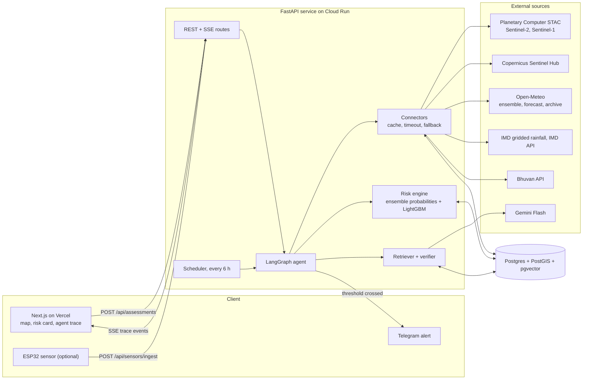
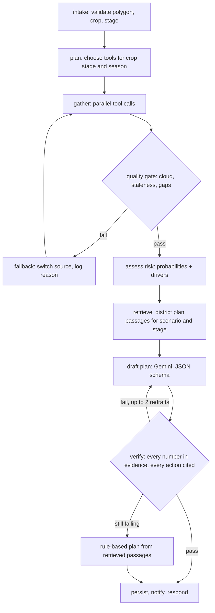

# KhetKavach Architecture

Source: `docs/STRATEGY.md` section F. One API service, one database, one frontend, with a
LangGraph agent at the centre. The agent calls deterministic tools for data and numbers and uses
the LLM only for wording the cited action plan. Every external call goes through the connector
layer (cache, timeout, one retry, fallback).

## Component diagram

## Agent graph

Every transition streams to the UI as a trace event and is persisted in `agent_steps`.

## Components

**Next.js frontend (Vercel).** The only user-facing surface, in two routes. `/` is a landing page
whose live-status block reads `GET /health` and `GET /api/districts` from the browser and says
"unavailable" when the API cannot answer. `/app` is the workspace: a dashboard shell with a
sidebar (Fields, Assess, Time Machine, Admin), a resizable split between the map plus agent trace
and the panels plus results, and a bottom sheet for the panels on a phone. An agronomist draws a
field polygon (MapLibre + Terra Draw) or searches a village, enters crop and sowing date, starts an
assessment, and watches the agent's trace stream live over SSE. The risk card is a bento grid of
risk tiles, Recharts evidence charts, the cited plan and a provenance table listing every source,
status and fetch time, in English, Hindi or Punjabi. It talks only to our API (and displays Esri
map tiles) and never holds an API key.

**Telegram.** Delivery channel for alerts to agronomists and farmers. A bot webhook links a chat
to a field via `/start <field code>`; the agent posts an alert when risk crosses a threshold.
Chosen because it is free and instantly demoable.

**ESP32 sensor (optional).** An in-field soil-moisture probe that posts readings to
`/api/sensors/ingest` with a device key. Only built if hardware exists; otherwise soil moisture
comes from Open-Meteo's modelled layer and is labelled "modelled".

**REST + SSE routes (FastAPI).** The API boundary: field CRUD, assessment creation (202 +
`assessment_id`), assessment retrieval, the SSE stream of trace events, sensor ingest, the
monitor job trigger, and `/health` (at the root, no `/api` prefix: the probe path for Docker,
Cloud Run and the live-status block on the landing page). Validates input with Pydantic v2 and
returns 422 with a reason for bad polygons, dates, or crops. Every non-2xx answer uses one error
envelope (`app/errors.py`), including 405, 429 and 500, and the write routes carry an in-memory
per-client rate limit (`app/ratelimit.py`, ruling B-22). Kicks off the agent asynchronously and
fans its step events to the stream.

**LangGraph agent.** Orchestrates an assessment as a state graph: intake, plan, parallel gather,
quality gate with fallback loop, risk assessment, retrieval, drafting, verification, and
persistence. It owns control flow only; data comes from connectors, numbers from the risk
engine, passages from the retriever. Retries and fallbacks are explicit graph edges so they show
up in the trace. Time and memory are bounded for a 512 MB host: two runs at once (others queue), one
raster tool at a time, 35 s per tool, a 75 s budget after which the plan is quoted without another LLM
call, and a 150 s hard deadline. Trace rows are written in order by a background task so no step
waits on the database. Runs left unfinished by a dead process are closed by `reap_stale_runs`
(`app/agent/persist.py`) at start-up and from the SSE stream.

**Risk engine.** Deterministic code that turns evidence into probabilities: the share of the 51
ECMWF (plus 31 GFS) ensemble members exceeding a crop-relevant threshold for dry spell and heavy
rain, weighted by crop-stage sensitivity, with a LightGBM dry-spell model evaluated against
climatology as a P1 addition. When an input is unavailable it widens uncertainty rather than
filling a value. Outputs yield-risk exposure, not tonnes per hectare.

**Retriever + verifier.** CRIDA plans are extracted with PyMuPDF and split at scenario headings,
so each chunk belongs to one contingency scenario. Retrieval filters by district, scenario and
crop, then fuses pgvector cosine rank (paraphrase-multilingual-MiniLM-L12-v2 via fastembed,
384-dim, CPU) with Postgres full-text rank. The API never loads the embedding model, which does not
fit in 512 MB: `scripts/build_query_vectors.py` embeds every possible agent query at image build, and
a query outside that file uses full-text rank alone. Gemini Flash (Groq backup; Gemini is skipped for
10 minutes after a failure) drafts a JSON-schema plan
whose actions cite chunk ids. The deterministic verifier normalises Hindi/Punjabi digits, rejects
any number not in the evidence or the cited passage, any date outside the forecast window and any
missing citation, forcing up to two redrafts (three drafts total), then falls back to a
rule-based plan quoted directly from the passages.

**Time Machine.** `as_of` from 2024-03-14 replays the ECMWF IFS run actually issued that day
(Open-Meteo Single Runs API: a yes/no outcome). Earlier dates have no archived forecast, so the
dry-spell risk comes from the LightGBM model on IMD rain observed up to the day before, and other
hazards from IMD climatology. The Historical Forecast API is never used for replays: it stitches
the first hours of every run together, which would leak observed weather into the "forecast".

**Scheduler.** Cloud Scheduler calls `POST /api/jobs/monitor` with the admin key every 6 hours
(Cloud Run scales to zero, so an in-process timer would silently stop). Re-assesses each monitored field via the same agent
and triggers alerts on threshold crossings.

**Connectors.** The sole gateway to the outside world. Each connector wraps one source with a
timeout (8 s weather, 20 s imagery), one retry with backoff, a named fallback source, then the
last cached real value, backed by a read-through `api_cache`. Every returned value carries
`source`, `fetched_at`, and a status (live/cached/archived/unavailable). If nothing real exists
the status is "unavailable", never a placeholder. An admin kill switch makes a source skip its
upstream call and serve its last real cached response (flagged `cached`, with a note) or report
"unavailable" so the agent falls back. Slow SDK reads, such as the Planetary Computer history, are
cached window by window under a time budget, so a retry resumes and a timeout costs history years,
not the whole answer.

**Postgres + PostGIS + pgvector.** The only datastore (Neon). Holds field polygons, the response
cache, observations, pre-loaded IMD daily rainfall, assessments, the agent step trace, RAG
vectors, sensor readings, and alert subscriptions/history.

**External sources.** Planetary Computer STAC (Sentinel-2/1) with Copernicus Sentinel Hub as
fallback; Open-Meteo for ensemble, forecast, and archive (NASA POWER fallback); IMD gridded
rainfall for history and climatology; OpenStreetMap Nominatim for district boundaries and
village search (via `/api/geocode`); Gemini Flash (Groq backup) for plan drafting only. The IMD
API overlay and Bhuvan are optional and unused.
