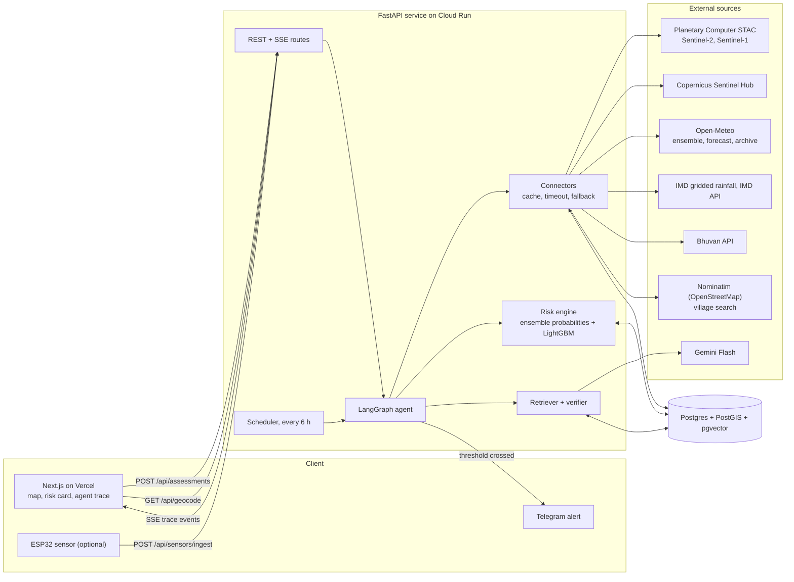

# KhetKavach Architecture

Source: `docs/STRATEGY.md` section F. One API service, one database, one frontend, with a
LangGraph agent at the centre. The agent calls deterministic tools for data and numbers and uses
the LLM only for wording the cited action plan. Every external call goes through the connector
layer (cache, timeout, one retry, fallback).

## Component diagram

## Agent graph

Every transition streams to the UI as a trace event and is persisted in `agent_steps`.

## Components

**Next.js frontend (Vercel).** The only user-facing surface. Lets an agronomist draw a field
polygon (MapLibre + Terra Draw) or search a village, enter crop and sowing date, start an
assessment, and watch the agent's trace stream live over SSE. Renders the risk card (Recharts
evidence charts, plan with citations, a provenance panel listing every source and fetch time) and
Hindi/regional-language output. It talks only to our API and never holds an API key.

**Telegram.** Delivery channel for alerts to agronomists and farmers. A bot webhook links a chat
to a field via `/start <field code>`; the agent posts an alert when risk crosses a threshold.
Chosen because it is free and instantly demoable.

**ESP32 sensor (optional).** An in-field soil-moisture probe that posts readings to
`/api/sensors/ingest` with a device key. Only built if hardware exists; otherwise soil moisture
comes from Open-Meteo's modelled layer and is labelled "modelled".

**REST + SSE routes (FastAPI).** The API boundary: field CRUD, assessment creation (202 +
`assessment_id`), assessment retrieval, the SSE stream of trace events, sensor ingest, the
monitor job trigger, and `/health`. Validates input with Pydantic v2 and returns 422 with a reason
for bad polygons, dates, or crops. Kicks off the agent asynchronously and fans its step events to
the stream.

**LangGraph agent.** Orchestrates an assessment as a state graph: intake, plan, parallel gather,
quality gate with fallback loop, risk assessment, retrieval, drafting, verification, and
persistence. It owns control flow only; data comes from connectors, numbers from the risk
engine, passages from the retriever. Retries and fallbacks are explicit graph edges so they show
up in the trace.

**Risk engine.** Deterministic code that turns evidence into probabilities: the share of the 51
ECMWF (plus 31 GFS) ensemble members exceeding a crop-relevant threshold for dry spell and heavy
rain, weighted by crop-stage sensitivity, with a LightGBM dry-spell model evaluated against
climatology as a P1 addition. When an input is unavailable it widens uncertainty rather than
filling a value. Outputs yield-risk exposure, not tonnes per hectare.

**Retriever + verifier.** The retriever runs pgvector search (multilingual-e5-small, 384-dim)
over ICAR-CRIDA district contingency plan chunks for the scenario, crop, and stage. Gemini Flash
drafts a JSON-schema plan whose actions are keyed to passage ids. The verifier rejects any number
not in the evidence and any action without a citation, forcing up to two rewrites, then falls
back to a rule-based plan built directly from the passages.

**Scheduler.** Runs every 6 hours (APScheduler in-process, or an external caller hitting
`POST /api/jobs/monitor` with an admin key). Re-assesses each monitored field via the same agent
and triggers alerts on threshold crossings.

## Persistence and API scaffold (as built)

- **Schema.** `apps/api/app/models/tables.py` maps every table in `CONTRACTS.md` (SQLAlchemy 2,
  GeoAlchemy2 for `fields.geom`, pgvector for `doc_chunks.embedding`). `apps/api/migrations/`
  (Alembic) owns the DDL: `0001_initial` enables `postgis` and `vector` and creates all 12 tables,
  the GiST index on `fields.geom` and the HNSW index on `doc_chunks.embedding`. `uv run alembic
  check` must report no drift.
- **Contracts in code.** `apps/api/app/schemas/` holds the Pydantic v2 models for every request,
  response and SSE event. The TypeScript types in `apps/web/lib/api-types.ts` are generated from
  `/openapi.json` by `pnpm gen:api-types`.
- **Scaffolded endpoints.** Every endpoint except `/health` validates its input (422 with a
  reason) and then returns 501 `NOT_IMPLEMENTED`, documented in OpenAPI. Each stub is replaced by
  the prompt that implements it.
- **Health.** `GET /health` runs `SELECT 1` and reads `source_switches`. It returns 503 only when
  the database is down.

**Connectors.** The sole gateway to the outside world. Each connector wraps one source with a
timeout (8 s weather, 20 s imagery), one retry with backoff, a named fallback source, then the
last cached real value, backed by a read-through `api_cache`. Every returned value carries
`source`, `fetched_at`, and a status (live/cached/archived/unavailable). If nothing real exists
the status is "unavailable", never a placeholder.

**Postgres + PostGIS + pgvector.** The only datastore (Neon). Holds field polygons, the response
cache, observations, pre-loaded IMD daily rainfall, assessments, the agent step trace, RAG
vectors, sensor readings, and alert subscriptions/history.

**External sources.** Planetary Computer STAC (Sentinel-2/1) with Copernicus Sentinel Hub as
fallback; Open-Meteo for ensemble, forecast, and archive (NASA POWER fallback); IMD gridded
rainfall for history and the IMD API for an optional warnings overlay; Bhuvan for reverse
geocoding; Nominatim (OpenStreetMap) for village search, called only by the backend through
`GET /api/geocode`, never by the browser; Gemini Flash for plan drafting only.
